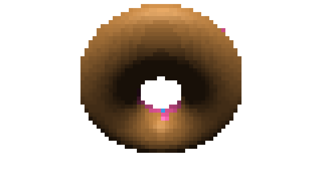

# JScheme

An **interpreter for JavaScript** as defined by [ECMA-262, 1st edition](/spec/ECMA-262_1st_edition_june_1997.pdf), implemented in [Scheme](https://en.wikipedia.org/wiki/History_of_the_Scheme_programming_language).

How it is built:

> Humans own the spec and the tests.
> An agent writes the entire implementation, driven only by the test feedback loop.
> No human ever reads the implementation.

## Principles

1. **The spec is the oracle.**
   ECMA-262 1st edition is the source of truth.
2. **The spec beats the tests.**
   A test that contradicts the spec is a bug in the test.
3. **The implementation is a black box.**
   Humans do not read `src/`, correctness is judged by the tests.

## Usage

```sh
jscheme              # Start the REPL on stdin.
jscheme <file.js>    # Evaluate a file.
jscheme -e <source>  # Evaluate `<source>`.
```

## Getting started

Requires [mise](https://mise.jdx.dev/), which provides Scheme and Go.
No JavaScript runtime is part of the toolchain.

```sh
mise install         # Install pinned tool versions.
mise run build       # Build bin/jscheme from src/.
mise run test        # Build, then run go test against bin/jscheme.
```

## Examples

The programs in [`examples/`](examples/) run on the JScheme interpreter as is.
Build first with `mise run build`.

### Factorial

```sh
./bin/jscheme examples/1-factorial.js
```

```text
0! = 1
1! = 1
2! = 2
3! = 6
4! = 24
5! = 120
6! = 720
7! = 5040
8! = 40320
9! = 362880
10! = 3628800
11! = 39916800
12! = 479001600

25!  = 1.5511210043330986e+25
170! = 7.257415615307994e+306 (recursive)
170! = 7.257415615308004e+306 (loop)
171! = Infinity (too big for a double)
```

### Fibonacci

```sh
./bin/jscheme examples/2-fibonacci.js
```

```text
recursive : fib(0..20) = 0 1 1 2 3 5 8 13 21 34 55 89 144 233 377 610 987 1597 2584 4181 6765
memoised  : fib(50)    = 12586269025
iterative : fib(78)    = 8944394323791464
```

### Mandelbrot set (ASCII)

```sh
bin/jscheme examples/3-mandelbrot.js
```

```text
................,,,,,,,,,,,,,,,,,,,,,,,,,,,,,,,,,,,,,,,,,,,,,,,,,,,,,,,,,,,,,,
...............,,,,,,,,,,,,,,,,,,,,,,,,,,,,,,,,,,,,----,,,,,,,,,,,,,,,,,,,,,,,
.............,,,,,,,,,,,,,,,,,,,,,,,,,,,,,,,,,,,,---;----,,,,,,,,,,,,,,,,,,,,,
............,,,,,,,,,,,,,,,,,,,,,,,,,,,,,,,,,,,-----:=:;:--,,,,,,,,,,,,,,,,,,,
...........,,,,,,,,,,,,,,,,,,,,,,,,,,,,,,,,,,,-----:::*::---,,,,,,,,,,,,,,,,,,
...........,,,,,,,,,,,,,,,,,,,,,,,,,,,,,,,,,-----=;;=@@;:;-----,,,,,,,,,,,,,,,
..........,,,,,,,,,,,,,,,,,,,,,,,,,,,,,,,,-------:;%@@@@#:-------,,,,,,,,,,,,,
.........,,,,,,,,,,,,,,,,,,,,,,,,,,,,,,--------:::;@@@@@+:::-------,,,,,,,,,,,
........,,,,,,,,,,,,,,,,,,,,,,,,,,,------:@;::;@;*%**@@*#*@;@::::::--,,,,,,,,,
........,,,,,,,,,,,,,,,,,,,,,,----------::=@@=@@@@@@@@@@@@@@@@;=#+*:--,,,,,,,,
.......,,,,,,,,,,,,,,,,,,,-------------:::;+@@@@@@@@@@@@@@@@@@@@@@:---,,,,,,,,
.......,,,,,,,,,,,,,,,,---------------:=@*@@@@@@@@@@@@@@@@@@@@@@@;:----,,,,,,,
.......,,,,,,,,,,,,,----;::--:;:----:::;@@@@@@@@@@@@@@@@@@@@@@@@@@;:;--,,,,,,,
......,,,,,,,,,,,,------:;+*;:;#:+::::=@@@@@@@@@@@@@@@@@@@@@@@@@@@+%:--,,,,,,,
......,,,,,,,,,,--------::+@@@@@@@+;:;@@@@@@@@@@@@@@@@@@@@@@@@@@@@@;:--,,,,,,,
......,,,,,,,,-------:::;#%@@@@@@@@@#=@@@@@@@@@@@@@@@@@@@@@@@@@@@@@:---,,,,,,,
......,,,,,,,------::;;;;@@@@@@@@@@@@+@@@@@@@@@@@@@@@@@@@@@@@@@@@@=----,,,,,,,
......-----:-:::::::;=@@@@@@@@@@@@@@@@@@@@@@@@@@@@@@@@@@@@@@@@@@@::----,,,,,,,
......-----:-:::::::;=@@@@@@@@@@@@@@@@@@@@@@@@@@@@@@@@@@@@@@@@@@@::----,,,,,,,
......,,,,,,,------::;;;;@@@@@@@@@@@@+@@@@@@@@@@@@@@@@@@@@@@@@@@@@=----,,,,,,,
......,,,,,,,,-------:::;#%@@@@@@@@@#=@@@@@@@@@@@@@@@@@@@@@@@@@@@@@:---,,,,,,,
......,,,,,,,,,,--------::+@@@@@@@+;:;@@@@@@@@@@@@@@@@@@@@@@@@@@@@@;:--,,,,,,,
......,,,,,,,,,,,,------:;+*;:;#:+::::=@@@@@@@@@@@@@@@@@@@@@@@@@@@+%:--,,,,,,,
.......,,,,,,,,,,,,,----;::--:;:----:::;@@@@@@@@@@@@@@@@@@@@@@@@@@;:;--,,,,,,,
.......,,,,,,,,,,,,,,,,---------------:=@*@@@@@@@@@@@@@@@@@@@@@@@;:----,,,,,,,
.......,,,,,,,,,,,,,,,,,,,-------------:::;+@@@@@@@@@@@@@@@@@@@@@@:---,,,,,,,,
........,,,,,,,,,,,,,,,,,,,,,,----------::=@@=@@@@@@@@@@@@@@@@;=#+*:--,,,,,,,,
........,,,,,,,,,,,,,,,,,,,,,,,,,,,------:@;::;@;*%**@@*#*@;@::::::--,,,,,,,,,
.........,,,,,,,,,,,,,,,,,,,,,,,,,,,,,,--------:::;@@@@@+:::-------,,,,,,,,,,,
..........,,,,,,,,,,,,,,,,,,,,,,,,,,,,,,,,-------:;%@@@@#:-------,,,,,,,,,,,,,
...........,,,,,,,,,,,,,,,,,,,,,,,,,,,,,,,,,-----=;;=@@;:;-----,,,,,,,,,,,,,,,
...........,,,,,,,,,,,,,,,,,,,,,,,,,,,,,,,,,,,-----:::*::---,,,,,,,,,,,,,,,,,,
............,,,,,,,,,,,,,,,,,,,,,,,,,,,,,,,,,,,-----:=:;:--,,,,,,,,,,,,,,,,,,,
.............,,,,,,,,,,,,,,,,,,,,,,,,,,,,,,,,,,,,---;----,,,,,,,,,,,,,,,,,,,,,
...............,,,,,,,,,,,,,,,,,,,,,,,,,,,,,,,,,,,,----,,,,,,,,,,,,,,,,,,,,,,,
................,,,,,,,,,,,,,,,,,,,,,,,,,,,,,,,,,,,,,,,,,,,,,,,,,,,,,,,,,,,,,,
```

### Mandelbrot set (colour)

```sh
./bin/jscheme examples/4-mandelbrot-color.js
```


Needs a true-colour terminal.

### Donut (colour)

```sh
./bin/jscheme examples/5-donut-color.js
```



Needs a true-colour terminal.

## Repository layout and ownership

| Path                  | Contents                                          | Owner                          |
| --------------------- | ------------------------------------------------- | ------------------------------ |
| `spec/`               | Spec PDF (canonical) + markdown, host contract | Humans |
| `tests/`              | `go test` suite | Humans |
| `src/`                | Interpreter implementation                    | Agent |

## Host contract

ECMA-262 leaves input/output and program invocation to the host environment (§4).

See [spec/host-contract.md](spec/host-contract.md) for invocation, exit codes, the `print` function, the REPL and implementation-defined behaviour.
